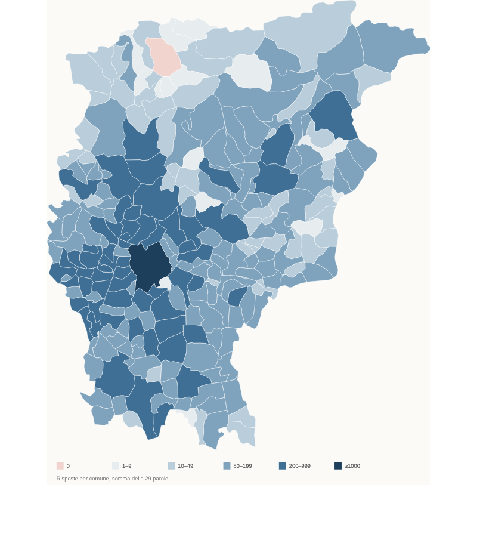

# ANALISI — Fase 1

Generato da `python3 build/analisi.py` (output in `analisi/`). Questa fase si ferma qui: servono le tue decisioni (in fondo) prima della pipeline statistica.

## 1. Cosa c'è nei dati

Fonte unica: `comesidice.xlsx`, 29 fogli "Risposte del modulo N", uno per parola (Google Form). Ogni foglio ha 3 colonne:

| Colonna nel file | Campo nella pipeline | Note |
|---|---|---|
| Informazioni cronologiche | `timestamp` | completa |
| Di che paese sei? | `comune` | menu a tendina: 243 comuni ISTAT, nomi puliti (solo `Villa d'Almè`/`Almè` da riallineare a `Villa d'Alme`/`Alme`) |
| Come dici …? | `variante` | opzioni del modulo + risposta libera "Altro" |
| Indirizzo email (solo modulo 11) | — | colonna vuota, 0 valori: nessun dato personale da gestire |

Campi del brief **assenti** e conseguenze:

- **id_rispondente**: assente. I rispondenti unici sono quindi stimabili solo per parola. Unica eccezione: i moduli 23, 24, 27, 28 (i quattro assi) hanno marche temporali identiche, sono lo stesso questionario e quindi gli stessi 882 rispondenti.
- **frazione**: assente. La geolocalizzazione parte dal comune, quindi il passo "punti casuali dentro le sezioni di censimento abitate pesati per popolazione" diventa essenziale per evitare l'effetto puntaspilli.
- **età**: assente. Nella fase C l'unica covariata possibile è geografica (altitudine, valle).
- **commento**: assente. Propongo di usare come commenti le 46 risposte libere che spiegano qualcosa ("Sàss se piccolo, Plòch più grosso"); vedi decisione D6.

## 2. Numeri principali

- **36.130 risposte** su **29 parole**, raccolte tra il 29/03/2023 e l'08/10/2023.
- **Rispondenti unici**: non identificabili. Per parola vanno da 485 (Pop Corn) a 2.244 (Gallina); sommando i questionari distinti (26 moduli indipendenti + 1 per i quattro assi) sono 33.484 compilazioni, con molte persone che hanno risposto a più moduli.
- **Copertura**: 242 comuni su 243 hanno almeno una risposta; scoperto solo **Piazzatorre**. Bergamo città ne ha 1.488 (in media 51 per parola).
- **Mediana per comune e per parola**: tra 1 (Libellula, Pop Corn, talpa) e 6 (Gallina, maiale, Roncola). Per la maggior parte delle parole oltre metà dei comuni ha meno di 5 risposte: lo smoothing spaziale è indispensabile.
- **Comuni con meno di 20 risposte in totale** (26): Piazzatorre 0, Valnegra 1, Valleve 1, Cornalba 2, Olmo al Brembo 3, Isso 3, Castro 4, Isola di Fondra 4, Moio de' Calvi 4, Foppolo 5, Songavazzo 5, Fonteno 5, Orio al Serio 6, Valgoglio 8, Averara 8, Aviatico 9, Piazzolo 10, Vedeseta 11, Torre Pallavicina 12, Azzone 13, Oltressenda Alta 13, Bossico 14, Lenna 15, Misano di Gera d'Adda 19, Vigolo 19, Mezzoldo 19. In gran parte alta Val Brembana: lì la mappa sarà sbiadita.

Dettaglio per comune e parola: `analisi/copertura_per_parola.csv`.

## 3. Parole e varianti

"Principali" = forme con almeno l'1% delle risposte (e almeno 5), dopo aver unito le grafie che differiscono solo per accenti, dieresi, doppie, maiuscole e articolo. "Rare" = altre forme (numero di forme e di risposte). "Multiple" = risposte che citano due o più varianti. "Escluse" = "non lo so", "boh" e simili.

| Parola | Risposte | Comuni coperti | Comuni con <5 | Grafie grezze | Varianti principali (risposte) | Rare | Multiple | Commenti | Escluse |
|---|---:|---:|---:|---:|---|---:|---:|---:|---:|
| Gallina | 2244 | 225 | 94 | 16 | Poia (1926), Galina (308) | 5 (8) | 2 | 0 | 0 |
| maiale | 2160 | 225 | 99 | 79 | Sunì (988), Porsèl (532), Pursèl (230), Ciù (124), Roi (87), Cì (51), Bresà (34), Ciunì (30) | 25 (56) | 21 | 7 | 0 |
| Roncola | 2032 | 232 | 92 | 132 | Podet (943), Pighess (458), Corlass (234), Pigassa (175), Podeta (65), Fols (37) | 66 (112) | 4 | 4 | 0 |
| Sasso | 1810 | 225 | 104 | 62 | Plòch (1022), Sàss (638), Piòch (54), Corna (47) | 24 (39) | 4 | 6 | 0 |
| Pettegola | 1741 | 217 | 119 | 50 | petònega (1520), zabèta (145), tofa (30) | 25 (32) | 12 | 1 | 1 |
| Fradicio | 1698 | 209 | 117 | 167 | Maserét (757), Bagnàt (537), Trebatit (101), Méss (60), Trabatit (37), Maser (29) | 93 (171) | 4 | 0 | 2 |
| tasca | 1657 | 219 | 123 | 34 | Scarsèla (1005), Sacòcia (460), Gaiòfa (175) | 11 (11) | 4 | 2 | 0 |
| ciabatta | 1547 | 219 | 121 | 65 | sibra (819), sébra (410), saàta (160), söbra (128) | 18 (19) | 7 | 4 | 0 |
| Bagnato | 1469 | 206 | 129 | 34 | Bagnàt (1277), Méss (145) | 28 (46) | 0 | 1 | 0 |
| coperchio | 1436 | 213 | 125 | 26 | Coèrcc (1343), Taèl (51), Cuèrcc (38) | 2 (2) | 0 | 2 | 0 |
| grembiule | 1428 | 219 | 130 | 55 | bigaröla (458), scossàl (318), bigaröl (220), scossalina (124), scussàl (94), scussalina (50), bigarla (45), scossalì (39), scussàlì (27), bigarlina (26) | 11 (12) | 8 | 7 | 0 |
| Panettiere | 1359 | 210 | 136 | 32 | Fornér (880), Prestinér (270), Panetér (196) | 10 (10) | 3 | 0 | 0 |
| cotechino grigliato | 1314 | 209 | 140 | 21 | Codeghì (467), Strinù (439), Cudeghì (377) | 6 (23) | 4 | 4 | 0 |
| Macellaio | 1273 | 209 | 128 | 25 | Macelér (755), Bechér (504) | 14 (14) | 0 | 0 | 0 |
| ragnatela | 1250 | 211 | 139 | 53 | Tiramola (677), Telemora (246), Talamora (99), Tilamora (50), Tilimora (44), Telimora (44), Tiramora (43), Porana (20) | 14 (23) | 2 | 1 | 1 |
| Imbuto | 1241 | 216 | 137 | 25 | Pedriöl (1171), Turtaröl (56) | 13 (14) | 0 | 0 | 0 |
| Fiammifero | 1091 | 210 | 160 | 40 | Solfanèl (537), Fiamifer (333), Solferì (153), Fölminànt (34) | 25 (33) | 1 | 0 | 0 |
| Albicocca | 934 | 186 | 169 | 29 | Bignaga (474), Mignaga (266), Albicòch (165), Mugnaga (25) | 3 (3) | 0 | 1 | 0 |
| orologio | 929 | 195 | 165 | 38 | Orolòi (414), Leròi (240), Urlòi (147), Relòi (107) | 17 (21) | 0 | 0 | 0 |
| l'Asso di Spade | 882 | 175 | 178 | 15 | l'ass de spade (810), ol taiamerde (58) | 11 (13) | 0 | 0 | 1 |
| l'Asso di Ori | 882 | 175 | 178 | 122 | ol borla (317), l'ass de ori (288), la bola (65), La polenta (52), La cüla (32), la formaggia (30), la burlina (11) | 71 (82) | 4 | 1 | 0 |
| l'Asso di Coppe | 882 | 175 | 178 | 38 | ol pisì (274), l'ass de coppe (245), ol pisalobia (179), ol pisagì (156) | 25 (26) | 0 | 1 | 1 |
| l'Asso di Bastoni | 882 | 175 | 178 | 6 | l'ass de bastù (458), ol vincerai (329), ol bastù (93) | 2 (2) | 0 | 0 | 0 |
| Briciole | 855 | 201 | 177 | 43 | Migole (309), Migle (194), Gandaie (138), Fregoie (103), Fregói (40), Gandài (37) | 24 (33) | 0 | 0 | 1 |
| Ombelico | 827 | 191 | 177 | 50 | butù (686), bigol (88) | 41 (51) | 0 | 1 | 1 |
| Scapolo | 779 | 190 | 181 | 26 | Pötvecc (326), Barba (206), Marèll (106), Pöt (99), Barbì (26) | 12 (15) | 0 | 1 | 0 |
| talpa | 547 | 179 | 213 | 41 | tópa (282), topinéra (120), tarfù (69), Talpa (22), Tapinera (22), Tupina (16), farfù (6) | 8 (9) | 0 | 1 | 0 |
| Libellula | 496 | 159 | 213 | 22 | becaöcc (388), scanaöcc (78), Caaöcc (13) | 12 (15) | 0 | 1 | 1 |
| Pop Corn | 485 | 162 | 209 | 56 | s-cioparöle (151), méche (131), culumbine (72), s-ciuparöle (38), colombine (21), culumbele (9), colombele (5) | 44 (54) | 0 | 0 | 4 |

L'elenco completo, forma per forma con i conteggi, è in **`analisi/varianti_proposte.yaml`**: è la bozza di `varianti.yaml` da correggere.

## 4. Anomalie

1. **Risposte multiple** (80): "Poia o Galina", "Sia sàss che plòch", "Sunì/Roi". Più frequenti in maiale (20), Pettegola (10), grembiule (6).
2. **Risposte-commento** (46): spiegazioni di differenze di significato (Sasso: piccolo/grande; grembiule: intero/da vita; cotechino: crudo/grigliato). Indicano che per alcune parole le varianti sono in parte **sinonimi con sfumature diverse**, oltre che varianti geografiche.
3. **Risposte scherzose o fuori tema**: soprattutto nell'Asso di Ori (122 grafie, molte goliardiche: "Ol cul del nono", "La padella"), Macellaio ("li muerti…"), maiale ("Bresà", "Bresciano": 34 risposte, insulto per i bresciani più che variante del nome dell'animale).
4. **Risposte in italiano** (Albicocca, Talpa, Libellula, Ragnatela, Imbuto, Pop corn): poche unità per parola; propongo di escluderle dalla stima.
5. **Quasi-duplicati**: 99 coppie con stesso comune e stessa risposta a meno di 5 secondi di distanza (14 in Gallina). Probabili doppi invii; propongo di scartare il secondo.
6. **Parole con pochi dati**: Pop Corn (485), Libellula (496), talpa (547): mappe affidabili solo nelle zone più popolose.
7. **Fradicio e Bagnato** sono state raccolte lo stesso giorno, a 20 minuti di distanza, con le stesse opzioni: molti hanno risposto "Bagnàt" anche a Fradicio. Vanno lette insieme.
8. **Bergamo città** pesa il 4% delle risposte: col kernel a k vicini questo non distorce la mappa, perché la banda si restringe dove i dati sono densi.

## 5. Proposte di accorpamento

Regole applicate automaticamente nella bozza (da confermare):

- unisco grafie con stessa chiave dopo aver tolto accenti, dieresi, doppie, maiuscole, articoli (`ol`, `la`, `l'`) e note tra parentesi: `Scarsèla`/`scarsèla`, `Pedriöl`/`Pedreöl`, `Coèrcc`/`Coerc`;
- aggancio una forma rara alla principale più simile (similarità ≥ 0,8): `Sufranèl` → `Solfanèl`, `Pighesot` → `Pighess`;
- divido le risposte multiple in parti uguali tra le varianti citate (peso 1/k);
- escludo "non lo so" e simili.

**Coppie su cui serve la tua decisione** (le tengo separate finché non dici di unirle; ognuna ha numeri sufficienti per una mappa propria):

| Parola | Forme candidate all'unione | Natura della differenza |
|---|---|---|
| cotechino grigliato | Codeghì (467) / Cudeghì (377) | o/u, pronuncia |
| maiale | Porsèl (533) / Pursèl (230); Sunì (988) / Ciunì (30) / Ciù (124) / Cì (51) | o/u; diminutivo |
| Panettiere | Fornér (880) / Furnér (≈20, già unito) | o/u |
| ciabatta | sibra (819) / sébra (410) / söbra (128) | vocale tonica |
| Briciole | Migole (309) / Migle (194); Fregoie (103) / Fregói (40); Gandaie (138) / Gandài (37) | sincope; plurale femminile/maschile |
| Fradicio | Trebatit (101) / Trabatit (37) / Trobatit; Maserét (757) / Maser (29) | vocale; suffisso |
| Roncola | Podet (943) / Podeta (65); Pighess (458) / Pigassa (175) | genere/suffisso |
| Scapolo | Pötvecc (326) / Pöt (99); Barba (206) / Barbì (26) | composto; diminutivo |
| grembiule | bigaröla / bigaröl / bigarla / bigarlina; scossàl / scussàl / scossalina / scussalina / scossalì / scussàlì | genere, o/u, diminutivo |
| ragnatela | Tiramola / Telemora / Talamora / Tilamora / Tilimora / Telimora / Tiramora | vocali |
| Pop Corn | s-cioparöle / s-ciuparöle; culumbine / colombine / culumbele / colombele | o/u, suffisso |
| orologio | Orolòi / Urlòi; Leròi / Relòi | vocale iniziale; metatesi |
| Sasso | Plòch (1022) / Piòch (54) | pl/pi |
| Albicocca | Bignaga / Mignaga / Mugnaga | consonante iniziale |
| coperchio | Coèrcc (1343) / Cuèrcc (38) | o/u |
| l'Asso di Ori | ol borla / la bola / la burlina | genere, forma |

**Proposta**: in `varianti.yaml` ogni forma ha due livelli, `lessema` (famiglia di parole: tutte le forme di *scossàl* insieme) e `pronuncia` (scossàl, scussàl, scossalina…). La mappa di default colora per lessema, con 2–5 categorie leggibili come nel NYT; un interruttore "mostra pronunce" usa il livello fine, che è dove stanno le isoglosse più interessanti (o/u, sibra/sébra/söbra). Così nessuna informazione si perde.

## 6. Parametri proposti per la fase 2

| Parametro | Valore | Motivo |
|---|---|---|
| Griglia | H3 risoluzione 8 (~0,74 km²) | stima: ~3.700 esagoni sulla provincia (2.745 km²), da mascherare all'abitato |
| Maschera abitato | sezioni ISTAT 2021 con popolazione > 0 | come da brief |
| Punti per rispondente | 1 punto casuale in una sezione abitata del comune, pesato per popolazione | |
| Seed | 10, risultati mediati | da verificare in fase 2 confrontando la varianza tra seed |
| Banda kernel | distanza del k-esimo vicino, k = 30 (k = 20 per Pop Corn, Libellula, talpa) | con 1–6 risposte per comune, k = 30 abbraccia 5–10 comuni |
| Prior di Dirichlet | centrato sulle proporzioni provinciali, forza α = 5 risposte equivalenti | sposta poco dove n_eff > 30, molto dove n_eff < 5 |
| Soglia n_eff | 8: sotto sfuma verso il grigio | |
| Divisività | entropia media pesata per popolazione + quota di isoglosse nette | |
| Risposte multiple | peso 1/k per variante | |
| Quasi-duplicati | scarto il secondo invio entro 5 s | |

## 7. Riferimenti esterni e ambiente

- **Pagina NYT**: inaccessibile da qui (bloccata sia via fetch che via rete). Procedo con le specifiche del brief. Dalle fonti secondarie trovate: confini netti dove c'è accordo o una barriera fisica, sfumati dove c'è disaccordo o transizione, colore per consenso a livello di isolato.
- **Paper e codice McCartan** (arxiv, github): non raggiungibili da questo ambiente; la fase C seguirà la descrizione del brief.
- **Rete dell'ambiente**: bloccati pypi, npm, istat.it, nominatim, tiles.openfreemap.org, arxiv, github.com. Per le fasi 2–4 servono: `pypi.org`, `files.pythonhosted.org` (geopandas, h3, scipy, pymc), `registry.npmjs.org` (maplibre-gl, pmtiles), `www.istat.it` (sezioni di censimento), `tiles.openfreemap.org` e `nominatim.openstreetmap.org` (screenshot del frontend). Si abilitano in Network access delle impostazioni dell'ambiente.

## 8. Decisioni che ti chiedo

- **D1** Accorpamenti: confermi le regole automatiche del § 5 e il modello a due livelli lessema/pronuncia? Per ciascuna coppia della tabella: unire, tenere separate o solo nel livello pronuncia?
- **D2** ö/ò: il brief dice di unirle, però in bergamasco ö e o sono suoni distinti (söbra/sébra, Pöt). Propongo di unire solo le varianti grafiche di uno stesso suono (ô→ö, ó/ò→o) e tenere ö separata da o.
- **D3** Risposte scherzose: escludo Bresà/Bresciano (maiale), le forme oscene dell'Asso di Ori e le risposte in italiano?
- **D4** Asso di Ori/Coppe: tengo `l'ass de ori` come variante (è la risposta "nessun soprannome") o la escludo per mappare solo i soprannomi?
- **D5** Fradicio e Bagnato: due mappe distinte o una sola mappa "bagnato fradicio"?
- **D6** Commenti: va bene usare le risposte libere esplicative come contenuto del tab Commenti, mostrate senza dati personali (solo comune)?
- **D7** Parametri del § 6: ok o modifiche?

## 9. Decisioni prese (20/10/2026)

- **D1** Approvato il modello a due livelli. `varianti.yaml` ora contiene le regole (lessema → pronuncia → regex) e `build/normalizza.py` le applica. Il controllo, forma per forma, è in `analisi/assegnazioni.md`. In "Altre forme" resta lo 0,3% delle risposte (114).
- **D2** Approvato: ö resta separata da o quando distingue pronunce diverse (söbra/sébra/sibra), ed è unita quando è solo una grafia diversa dello stesso suono (cula/cüla, Mugnaga/Mügnaga). È il comportamento già in uso: ö e ü restano distinte nella chiave e `varianti.yaml` accorpa le grafie a livello di pronuncia.
- **D3** Escluse le risposte in italiano e quelle volgari senza motivo, più le battute (214 in tutto). Bresà resta: è una forma dialettale vera, anche se ironica.
- **D4** `l'ass de ori/coppe/bastù/spade` resta come variante.
- **D5** Fradicio e Bagnato restano due mappe distinte.
- **D6** Il tab Commenti si prova con le 39 risposte esplicative, mostrando solo il comune.
- **D7** Parametri scelti con la validazione incrociata della fase 2: k = 15 per tutte le parole, banda massima 6 km, α = 2 (vedi `VALIDAZIONE.md`).
